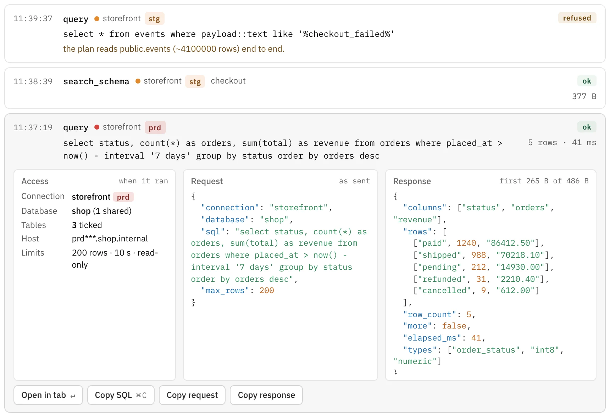

<p align="center">
  <picture>
    <source media="(prefers-color-scheme: dark)" srcset="docs/readme/banner-dark.png">
    
  </picture>
</p>

<p align="center">
  <a href="#download"><b>Download</b></a> ·
  <a href="#use-it-with-your-agent">Use it with your agent</a> ·
  <a href="#build-from-source">Build from source</a>
</p>

# Rowkery

A fast, keyboard-first Mac app for Postgres and SQLite, with a database server for your AI agent built in. Browse and edit your data yourself, or let any MCP client read it through Rowkery. Only you can change it.

- **Fast.** A Rust core, rows streamed as binary frames, and a grid that stays smooth on big tables.
- **Keyboard first.** ⌘K finds any table or command. The mouse works everywhere too.
- **Safe on production.** Each connection is tagged prd, stg, dev or local. Safe mode shows the exact SQL before a write, or refuses writes altogether.
- **Agents read, you write.** Share only the tables you pick. Agents get single read-only SELECTs with row and time limits, and every call lands in a log you can open. An agent can propose a change; nothing runs until you review its dry run and press Commit.
- **Yours.** No account and no sign-in. Passwords stay in your macOS Keychain.

<p align="center">
  <picture>
    <source media="(prefers-color-scheme: dark)" srcset="docs/readme/k-palette-dark.webp">
    
  </picture>
  <picture>
    <source media="(prefers-color-scheme: dark)" srcset="docs/readme/log-dark.webp">
    
  </picture>
</p>

## Download

Rowkery is in alpha and runs on macOS (Apple Silicon and Intel). Linux and Windows builds are unofficial: they build from source, but they aren't released or tested the way the Mac app is.

1. Download the `.dmg` from the [latest release](https://github.com/rowkery/rowkery/releases/latest).
2. Open it and drag **Rowkery** into **Applications**.
3. The alpha isn't signed by Apple yet, so macOS blocks the first launch. Choose **Open Anyway** in System Settings › Privacy & Security, or run:

   ```bash
   xattr -dr com.apple.quarantine /Applications/Rowkery.app
   ```

Rowkery checks for updates after launch and installs them when you restart it.
What changed in each version is in the [release notes](https://github.com/rowkery/rowkery/releases).

## Use it with your agent

1. Open a connection, then the **Agents** page, and turn sharing on for the databases and tables your agent may read.
2. Claude Desktop and Claude Code connect in one click from that page.
3. Any other MCP client runs Rowkery as a stdio server:

   ```json
   {
     "mcpServers": {
       "rowkery": {
         "command": "/Applications/Rowkery.app/Contents/MacOS/Rowkery",
         "args": ["--mcp"]
       }
     }
   }
   ```

Writes, multi-statement scripts and full scans of large tables are refused before they reach your database. A proposed change waits for you (⌘K › Review proposed changes) until you commit or reject it.

## Build from source

You need Rust (the version in `rust-toolchain.toml`), Node and Xcode's command line tools.

```bash
cd apps/rowkery-tauri
npm install
npm run tauri dev        # run with hot reload
```

From the repo root, `make dmg` builds a DMG for your Mac's chip and `make dmg universal` builds one for both. `make dev <branch>` or `make dev <PR number>` runs a branch or pull request.

On Linux the app needs WebKitGTK 4.1 and the other [Tauri prerequisites](https://v2.tauri.app/start/prerequisites/). Linux and Windows builds are unofficial.

The quality gate, browser proofs and commit conventions are in [CONTRIBUTING.md](CONTRIBUTING.md), and everyone taking part agrees to the [code of conduct](CODE_OF_CONDUCT.md).

<details>
<summary>Testing against Postgres</summary>

```bash
docker compose -f docker-compose.test.yml up -d postgres
export ROWKERY_PG_HOST=127.0.0.1 ROWKERY_PG_PORT=54329 ROWKERY_PG_USER=rowkery ROWKERY_PG_PASSWORD=rowkery ROWKERY_PG_DB=rowkery
cargo test -p rowkery-core --features postgres-integration postgres_connect_and_select
```

</details>

<details>
<summary>Releasing</summary>

Releases are published to this repo's GitHub Releases. The app reads the update feed (`releases/latest/download/latest.json` on this repo, which `scripts/release.sh` builds in) after launch and from **Rowkery › Check for Updates…**.

1. Once: `scripts/updater-key.sh` creates the update signing key and writes its public half into `tauri.conf.json`. Back up `~/.tauri/rowkery-updater.key` and its password outside the Mac; without them no installed copy can update again.
2. Bump the version in `tauri.conf.json`, `package.json` (and its lockfile) and `[workspace.package]` in the root `Cargo.toml`, write `docs/releases/v<version>.md`, and push.
3. `make release publish` builds the universal DMG, the signed update bundle and `latest.json`, and opens a draft release at that commit. Publish it as a full release, not a pre-release.

`scripts/update-rehearsal.sh` proves the update path on a Mac without publishing anything.

</details>

## Project layout

| Path | What's there |
| --- | --- |
| `crates/rowkery-core` | Rust core: Postgres and SQLite, introspection, queries, edits |
| `crates/rowkery-bridge` | The window API the app calls (`open_window`, `run_window_query`, …) |
| `crates/rowkery-mcp` | The MCP server agents talk to |
| `apps/rowkery-tauri` | The Mac app: Tauri 2, React, TypeScript |
| `apps/web` | The website (Next.js) |
| `apps/docs` | The docs at docs.rowkery.com (Next.js, MDX) |
| `apps/relay` | The Cloudflare Worker that files **Help › Report an Issue…** reports as issues in a private repo |
| `DESIGN.md`, `docs/spec.md` | Design tokens and the product spec |

## Security

See [SECURITY.md](SECURITY.md) for how to report a vulnerability and what Rowkery does and doesn't protect against.

## License

Rowkery is licensed under the [Apache License 2.0](LICENSE).

## Trademarks

The Rowkery name and the penguin logo are trademarks of the Rowkery project and are not licensed under the Apache License 2.0. If you fork or redistribute Rowkery, please give it your own name and icon. Using the name to refer to the project is fine.
