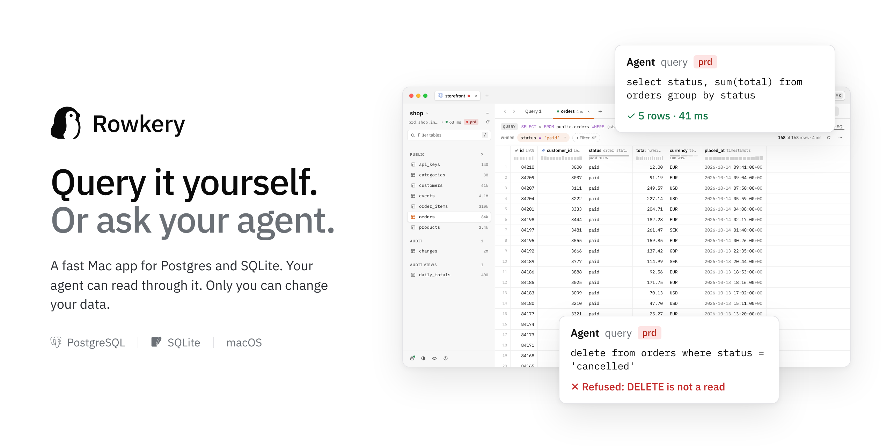
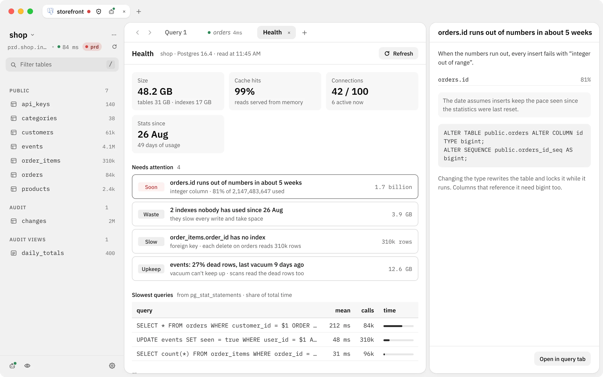
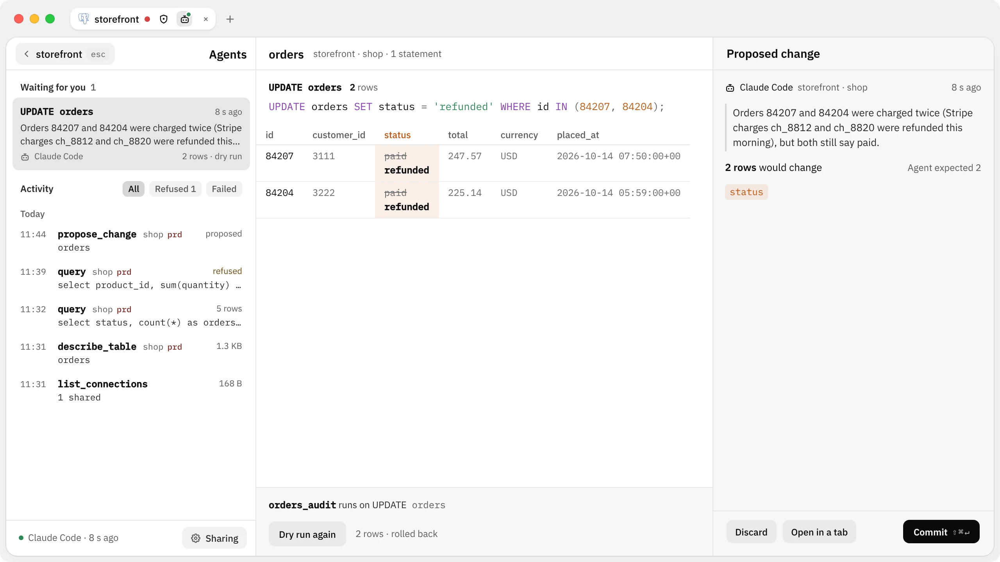
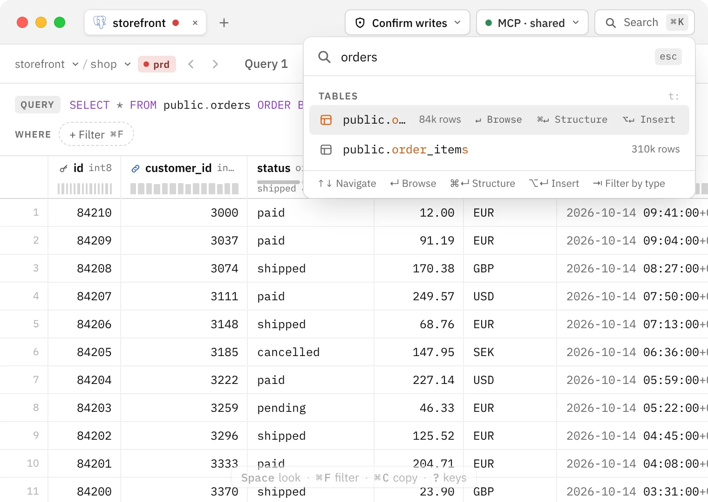

<p align="center">
  <picture>
    <source media="(prefers-color-scheme: dark)" srcset="docs/readme/banner-dark.png">
    
  </picture>
</p>

<p align="center">
  <a href="#download"><b>Download</b></a> ·
  <a href="https://docs.rowkery.com">Docs</a> ·
  <a href="#with-your-agent">With your agent</a> ·
  <a href="#build-from-source">Build from source</a>
</p>

# Rowkery

Rowkery is a Mac app for Postgres and SQLite. You browse and edit your data from the keyboard, and you can share the tables you pick with an AI agent, which reads them through a server built into the app. Only you can change anything.

It's free and open source, there's no account, and it connects straight from your Mac to your database.

## On your own

- **Quick from the keyboard.** ⌘K finds any table, recent query, connection or command. Hold ⌘ and every control shows its key. There are keymaps for TablePlus and DataGrip habits.
- **Tables without SQL.** Click a table, filter it with chips, sort from a header, and the exact SQL that produced the rows stays above the grid. Space opens a row in Quick Look, with its foreign keys followed.
- **Query tabs.** Completion from your schema, ⌘↵ runs the statement under the caret, each statement gets its own result, ⌘E shows the plan with one plain hint, ⌘I formats.
- **Edits you review.** Cell edits are staged until you commit them, and Review SQL shows the statements before they run.
- **Safe on production.** Tag each connection prd, stg, dev or local. Safe mode shows the exact SQL before a write, or refuses writes on that connection altogether.
- **Health.** What will hurt the database soon, from its catalog and statistics: an ID about to run out, indexes nobody uses, a table vacuum can't keep up with, the slowest queries. Each finding comes with the SQL that fixes it, which you run yourself.
- **Files in and out.** Import a CSV, run a `.sql` file through safe mode, export results as CSV, TSV, JSON or SQL inserts.
- **Also in the box.** Sessions on the server with cancel and end, a schema map, SSL and SSH tunnels, Google Cloud SQL without the proxy, and a macOS banner when a query, import or export finishes while you're in another app.
- **Yours.** Passwords stay in your macOS Keychain, and your data travels between your Mac and your database and nowhere else.

<p align="center">
  <picture>
    <source media="(prefers-color-scheme: dark)" srcset="docs/readme/health-dark.webp">
    
  </picture>
</p>

## With your agent

Rowkery has an [MCP](https://modelcontextprotocol.io) server built in, so Claude Code, Claude Desktop, Cursor or any other MCP client can read your database through it. It runs on your Mac, opens no port and needs no account.

1. Open the **Agents** page (⇧⌘A) and press **Sharing**. Turn sharing on for a connection and pick the databases and tables the agent may read.
2. Claude Code and Claude Desktop connect in one click from the same place.
3. Any other MCP client runs Rowkery as a stdio server:

   ```json
   {
     "mcpServers": {
       "rowkery": {
         "command": "/Applications/Rowkery.app/Contents/MacOS/Rowkery",
         "args": ["--mcp"]
       }
     }
   }
   ```

The agent can list what you shared, describe tables, search the schema, explain a plan, run a query, see what's running on the server, read the database's health, and propose a change.

What keeps it in bounds:

- **Reads only.** Each query is one SELECT on a read-only session, with at most 1,000 rows an answer and a time limit you set per connection. Writes, schema changes and a second statement are refused before anything reaches the database.
- **Only what you shared.** A query that reads a table you didn't share is refused, through views and joins too. A query that reads a big table end to end is refused as well, so an agent can't load a production server.
- **Sensitive columns.** Mark a column sensitive and the agent only ever gets a stand-in for its values. Presenting hides the same columns on your own screen.
- **Changes wait for you.** A proposed change lands on the Agents page with a dry run. Nothing runs until you press Commit, and the commit runs only if each statement still changes as many rows as the dry run showed.
- **Every call is logged.** The Agents page shows each call with what was shared at the time, the request as sent and the start of the response.

In clients that draw MCP Apps views, the agent's rows show as a grid in the chat and a proposal as a live card, each with a button that opens it in Rowkery. The [docs](https://docs.rowkery.com/connecting-to-agents/) cover every tool, limit and check.

<p align="center">
  <picture>
    <source media="(prefers-color-scheme: dark)" srcset="docs/readme/agents-dark.webp">
    
  </picture>
</p>

## Download

Rowkery is in beta and runs on macOS (Apple Silicon and Intel). The app is signed and notarized by Apple. Linux and Windows build from source, but they aren't released or tested the way the Mac app is.

1. Download the `.dmg` from the [latest release](https://github.com/rowkery/rowkery/releases/latest).
2. Open it and drag **Rowkery** into **Applications**.

The first launch opens a small sample database with its first query already run. Rowkery checks for updates after launch and installs them when you restart it; **Settings › Updates** (⌘,) chooses how. What changed in each version is in the [release notes](https://github.com/rowkery/rowkery/releases).

<p align="center">
  <picture>
    <source media="(prefers-color-scheme: dark)" srcset="docs/readme/k-palette-dark.webp">
    
  </picture>
</p>

## Build from source

You need Rust (the version in `rust-toolchain.toml`), Node and Xcode's command line tools.

```bash
cd apps/rowkery-tauri
npm install
npm run tauri dev        # run with hot reload
```

From the repo root, `make dmg` builds a DMG for your Mac's chip and `make dmg universal` builds one for both. `make dev <branch>` or `make dev <PR number>` runs a branch or pull request.

On Linux the app needs WebKitGTK 4.1 and the other [Tauri prerequisites](https://v2.tauri.app/start/prerequisites/). Linux and Windows builds are unofficial.

The quality gate, browser proofs and commit conventions are in [CONTRIBUTING.md](CONTRIBUTING.md), and everyone taking part agrees to the [code of conduct](CODE_OF_CONDUCT.md).

<details>
<summary>Testing against Postgres</summary>

```bash
docker compose -f docker-compose.test.yml up -d postgres
export ROWKERY_PG_HOST=127.0.0.1 ROWKERY_PG_PORT=54329 ROWKERY_PG_USER=rowkery ROWKERY_PG_PASSWORD=rowkery ROWKERY_PG_DB=rowkery
cargo test -p rowkery-core --features postgres-integration postgres_connect_and_select
```

</details>

<details>
<summary>Releasing</summary>

Releases are published to this repo's GitHub Releases. The app reads the update feed (`releases/latest/download/latest.json` on this repo, which `scripts/release.sh` builds in) after launch and from **Rowkery › Check for Updates…**.

1. Once, for a new fork: `scripts/updater-key.sh` creates the update signing key and writes its public half into `tauri.conf.json`. Back up `~/.tauri/rowkery-updater.key` and its password outside the Mac. Installed copies only accept updates signed with that key, so a new key strands every install made with the old one.
2. Bump the version in `tauri.conf.json`, `package.json` (and its lockfile) and `[workspace.package]` in the root `Cargo.toml`, write `docs/releases/v<version>.md`, and push.
3. The Apple Developer ID identity and notarization credentials go in `~/.config/rowkery/release.env` (the variables are listed at the top of `scripts/release.sh`), which the release loads by itself.
4. `make release publish` builds the universal DMG, the signed update bundle and `latest.json`, and opens a draft release at that commit. Publish it as a full release, not a pre-release.

`scripts/update-rehearsal.sh` proves the update path on a Mac without publishing anything.

</details>

## Project layout

| Path | What's there |
| --- | --- |
| `crates/rowkery-core` | Rust core: Postgres, SQLite and Cloud SQL, introspection, queries, edits, health checks |
| `crates/rowkery-bridge` | The window API the app calls (`open_window`, `run_window_query`, …) |
| `crates/rowkery-mcp` | The MCP server agents talk to, its guards and the proposal queue |
| `apps/rowkery-tauri` | The Mac app: Tauri 2, React, TypeScript |
| `apps/web` | The website (Next.js) |
| `apps/docs` | The docs at docs.rowkery.com (Next.js, MDX) |
| `apps/relay` | The Cloudflare Worker that files **Help › Report an Issue…** reports as issues in a private repo |
| `DESIGN.md`, `docs/spec.md` | The visual system and the product spec |

## Security

See [SECURITY.md](SECURITY.md) for how to report a vulnerability and what Rowkery does and doesn't protect against.

## License

Rowkery is licensed under the [Apache License 2.0](LICENSE).

## Trademarks

The Rowkery name and the penguin logo are trademarks of the Rowkery project and are not licensed under the Apache License 2.0. If you fork or redistribute Rowkery, please give it your own name and icon. Using the name to refer to the project is fine.
